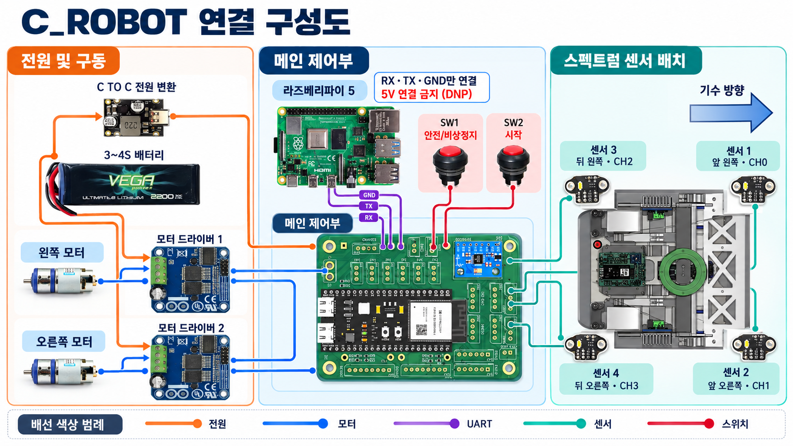
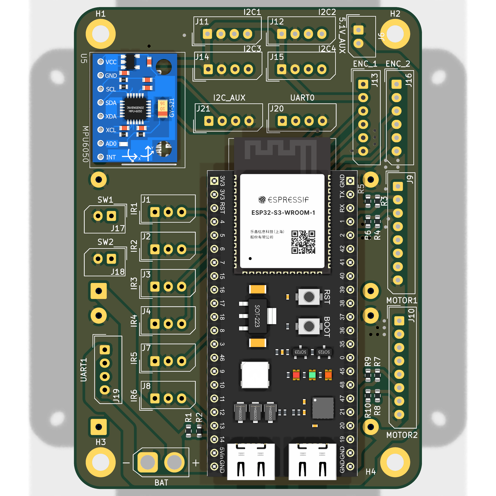
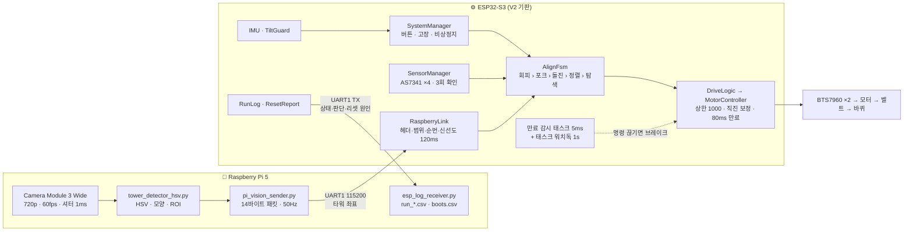
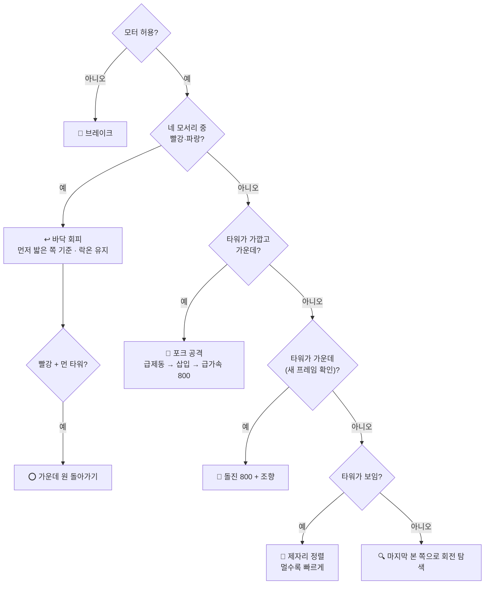
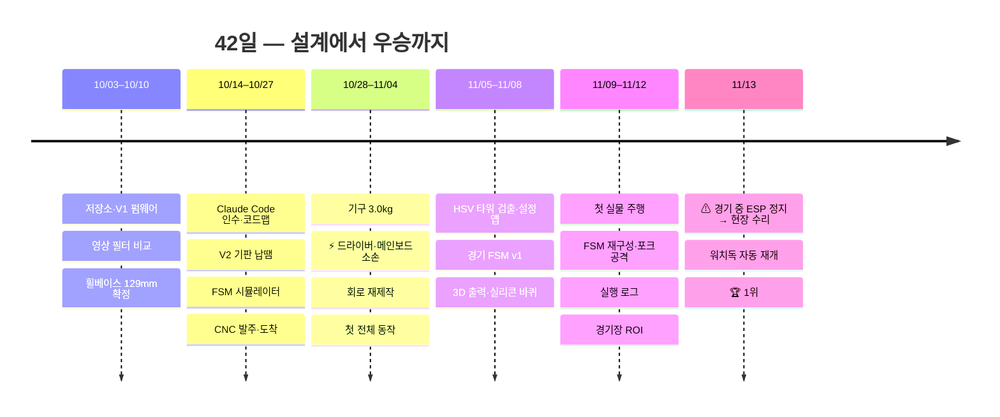
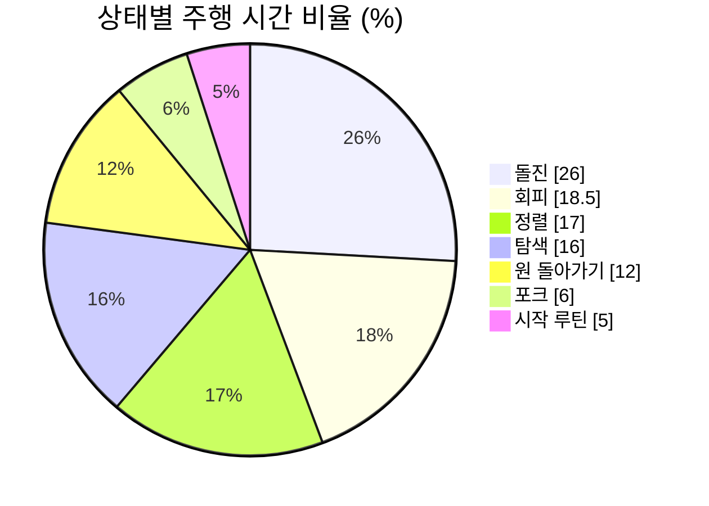

<div align="center">

# 🤖 C_ROBOT

### 2026 IRC 씨름 로봇 — 자율주행 스모 로봇 V2

**카메라로 상대를 찾고, 네 모서리 컬러 센서로 경기장 홈을 피하며, 포크로 상대를 밀어내는 4.5kg급 자율 로봇**

[-gold?style=for-the-badge)](IRC2026_RETROSPECTIVE.md)


[개요](#-개요) ·
[하드웨어](#-하드웨어) ·
[시스템 구조](#-시스템-구조) ·
[경기 펌웨어](#-경기-펌웨어) ·
[시작하기](#-시작하기) ·
[타임라인](#-타임라인) ·
[대회 데이터](#-대회-데이터) ·
[배운 것](#-배운-것) ·
[문서](#-문서-지도)

</div>

---

## 🏆 결과

> **2026-11-13, 2026 IRC 씨름 로봇 대회 1위 — 1점 차 우승.**
>
> 첫 설계부터 우승까지 42일. 모터 드라이버와 메인 보드가 타고, 회로를 처음부터 다시 만들고,
> 대회 당일 경기 중에 ESP32가 멈추는 문제를 현장에서 고쳐 가며 얻은 결과다.
> 우승 펌웨어는 태그 [`irc2026-final`](https://github.com/caconee22/c_robot/tree/irc2026-final)에 그대로 남아 있다.

| | |
|---|---|
| 📅 **기간** | 2026-10-03 → 2026-11-13 (42일), 정리 11/14 |
| 🧠 **제어** | ESP32-S3 단독 판단 · 루프 1~2ms · 모터 명령 80ms 만료 감시 |
| 👁️ **영상** | Raspberry Pi 5 + Camera Module 3 Wide · 720p 60fps · 좌표만 50Hz UART |
| 🎨 **바닥** | AS7341 스펙트럼 센서 ×4 · 12단계 교정 · 3/10/20mm 간격 변화 대응 |
| 📈 **기록** | 커밋 79 · PR 9 · 주행 로그 80개 · 분석 67판 61분 · AI 대화 27일 |

---

## 📖 개요

C_ROBOT은 **2026 IRC 씨름 로봇 대회**에 나간 자율주행 스모 로봇의 통합 저장소다.
펌웨어, 영상 처리, 회로·PCB, 기구, 팀 일정, 주행 로그, 그리고 개발 과정의 AI 대화까지 한곳에 있다.

경기 규칙의 핵심은 단순하다. 경기장 위에서 **상대 로봇(컬러 타워를 단)을 찾아 밀어내고**,
경기장 가장자리의 **빨강·파랑 홈에 빠지지 않는 것**이다. 사람이 조종하지 않는다.

```
     ┌─────────── 경기장 ───────────┐
     │  🔵 홈          🔴 가운데 원   │     👁️ 카메라  →  상대 컬러 타워 좌표
     │        🤖 ──▶  🎯 상대        │     🎨 바닥 센서 ×4 →  홈·원 색 판별
     │  🔵 홈                  🔵 홈 │     ⚙️ ESP32 →  찾기·정렬·돌진·포크·회피
     └──────────────────────────────┘
```

이 로봇의 설계 원칙 세 가지:

1. **판단과 안전은 ESP32 한 곳에서.** 라즈베리파이는 "타워가 화면 어디에 있나"만 보낸다. 라즈가 꺼져도 로봇은 멈추지 않고 바닥 회피와 안전 기능은 그대로 돈다.
2. **루프를 막지 않는다.** 센서 수광, I2C, UART, 로그를 모두 짧은 단계로 쪼개 메인 루프가 1~2ms마다 돈다. 명령이 80ms 안에 갱신되지 않으면 별도 태스크가 모터를 세운다.
3. **실물로 확인하지 않은 것은 확정하지 않는다.** PC 시험 18,000여 회 통과도 "실물 보증"으로 쓰지 않고, 모든 값에 실측 여부를 표시했다.

---

## 🔧 하드웨어

<div align="center">



<sub>연결 구성도. 버튼 역할은 11/11에 바뀌었다(아래 "안전 설계" 표).</sub>

</div>

| 구성 | 부품 | 비고 |
|---|---|---|
| 메인 제어기 | **YD-ESP32-S3** (ESP32-S3-WROOM-1) | 자체 설계 **V2 기판** 위. Wi-Fi·PSRAM·네이티브 USB는 쓰지 않음 |
| 영상 | **Raspberry Pi 5** + **Camera Module 3 Wide** | 720p 60fps, 셔터 1ms, HSV 검출 → UART1 115200bps |
| 바닥 센서 | **AS7341** 11채널 스펙트럼 ×4 | TCA9548A 먹스 채널 0~3, 자체 백색 LED, 네 모서리 |
| 자세 | **MPU6050** IMU | 뒤집힘 비상정지, 로그용 방향 추정 |
| 모터 드라이버 | **BTS7960** ×2 | 20kHz PWM, 모터당 EN 하나. 명령은 ±1000(천분율), 상한 1000 |
| 구동 | DC 기어드 모터 ×2 → **HTD5M 20T 벨트** → 실리콘 바퀴 ×4 | 휠베이스 129mm (180mm였던 이전 기체의 털림을 줄이려고) |
| 바퀴 | 식품용 실리콘(Shore A40) 주조 | 일회용 몰드, 65mm 예비 설계 |
| 전원 | 3S·4S LiPo (둘 다 자동 판정) | 라즈는 USB-C PD 모듈로 따로 |
| 프레임 | 6061 알루미늄 5T (JLCCNC 가공) + PLA·PETG 출력물 | 무게 4,150g 실측(11/4), 한도 4,545g |
| 입력 | SW1·SW2 버튼, 상태 LED(NeoPixel) | LED 10가지 상태 |

<details>
<summary><b>📐 V2 기판 (KiCad) 보기</b></summary>

<div align="center">

</div>

- 원본: [`PCBV2/`](PCBV2/) (KiCad), 펌웨어 핀의 원본은 [`ESP_MAIN/include/pins_v2.hpp`](ESP_MAIN/include/pins_v2.hpp)
- 커넥터·배선 지도: [`img/c_robot_wiring_connector_map.png`](img/c_robot_wiring_connector_map.png)
- 이전 V1 기판: [`PCB/`](PCB/) (구형 로봇 `yd_esp32_s3_v1_husky`용)

</details>

<details>
<summary><b>⚙️ 기구 설계 근거 (휠베이스, 벨트, 무게중심)</b></summary>

- 휠베이스 129mm: 제자리 회전 시 횡슬립이 180mm 대비 약 28% 줄어든다 (`π × 휠베이스`, 565 → 405mm).
- 벨트: 전륜-후륜 129mm 구간 360mm, 모터-전륜 79mm 구간 260mm, 아이들러로 장력.
- 무게중심 목표: 앞축 65~70%, 높이 약 60mm.
- 전체 기록: [`docs/DESIGN_20261010.md`](docs/DESIGN_20261010.md), 벨트 도면: [`mechanical/belt/`](mechanical/belt/), 무게중심 계산기: [`robot-cg-simulator.html`](robot-cg-simulator.html)

</details>

---

## 🧭 시스템 구조



**메인 루프 한 바퀴 (약 1~2ms)** — [`ESP_MAIN/src/main.cpp`](ESP_MAIN/src/main.cpp)

```text
① 안전 확인 → ② 라즈 좌표 (최대 128바이트) → ③ 바닥 색 (짧은 I2C 단계) → ④ 배터리·IMU
→ ⑤ 안전 재확인 (의도된 반복) → ⑥ FSM → ⑦ 좌우 출력 계산 → ⑧ 모터 (80ms 기한) → ⑨ LED·로그 (가장 낮은 우선순위)
```

라즈 통신은 **CRC를 일부러 쓰지 않는다.** 짧은 고정 배선이라 헤더·버전·길이·상태 비트·좌표 범위·sequence·신선도 검사로 충분하다고 판단했다.

---

## 🎯 경기 펌웨어

최종 경기 FSM은 대회 사흘 전(11/10) 실물 로그를 보고 **기능 하나씩 붙여 가며 다시 짠** `AlignFsm`이다
([`ESP_MAIN/include/control/align_fsm.hpp`](ESP_MAIN/include/control/align_fsm.hpp)).
매 루프 위에서부터 처음 해당하는 하나를 고른다.



| 기동 | 무엇을 하나 | 우승 펌웨어 값 |
|---|---|---|
| 🔍 탐색 | 마지막으로 본 쪽으로 제자리 회전 | 출력 500 |
| 🎯 정렬 | 화면 중심과의 오차에 비례해 제자리 회전 | 350~450 |
| 🚀 돌진 | 새 프레임으로 중앙 확인 뒤 조향하며 전진 | 800 (조향 ±150) |
| 🍴 포크 공격 | 가까이서 급제동 → 포크를 상대 아래로 → 급가속 | 800 / 삽입 480 |
| ↩️ 바닥 회피 | 먼저 위험색을 밟은 모서리 기준으로 빠짐. 밀려서 들어가면 더 세게 | 650 / 밀려 들어감 750 |
| ⭕ 원 돌아가기 | 가운데 빨간 원 + 먼 타워면 물러나 돌아서 호를 그림 | 후진 600 → 회전 400 → 호 450 |
| ▶️ 시작 루틴 | 왼쪽 45° → 직진 2초 → 왼쪽 90° | **대회 마지막 날 끔** |

- 모든 숫자의 원본: [`control_config.hpp`](ESP_MAIN/include/control/control_config.hpp)와 각 모듈 헤더의 `config::` 블록
- 노랑은 단차일 뿐이라 피하지 않는다. 판정이 애매한 색(Unknown)에서는 추가 기동을 하지 않는다.
- 이전 FSM(`RobotFsm`: 탐색·확인·정렬·접근·돌진·브레이크·삽입·밀기·무작위 순회)은 코드에 남아 있고 `ALIGN_ONLY_FSM=false`로 되돌릴 수 있다.

### 🎨 바닥 색 판별

추가 가림막 없이 **기체 하부 그늘 + 센서 자체 백색 LED**로 바닥을 본다. 경기장 홈에는 10mm 단차가 있어서
센서-바닥 간격이 **3mm(밀착) · 10mm(평평) · 20~25mm(턱에 걸침)** 로 계속 변한다.

- 수광 약 5ms, 게인 X16, LED 20mA로 시작해 실물에서 조정했다. 같은 색이 3번 나와야 확정한다.
- 유색은 **채널 비율**로, 검정은 **밝기**도 함께 본다. 근접 포화, 떠 있을 때 유색을 검정으로 읽는 문제, 색 경계 혼합을 늘 고려했다.
- **12단계 교정:** 빨강·파랑·검정(노랑은 따로 앞뒤 두 번) × 평평 10mm·들림 20mm·눌림 3mm. 칩마다 NVS에 저장한다.

### 🛡️ 안전 설계

| 입력 | 동작 |
|---|---|
| 정지 중 SW1 또는 SW2 | 출발 |
| 구동 중 아무 버튼 0.5초 | **비상정지** (EN 차단, 구동 금지 래치) |
| 비상정지 중 두 버튼 동시 0.5초 | 소프트 리셋: 래치 해제, FSM을 처음 상태로 → 출발 대기 (11/11 전에는 재부팅해야 풀렸다) |
| 전원 켤 때 두 버튼 1초 | 벤치·색 교정 모드로 부팅 |
| IMU 80° 넘게 1초 | 비상정지 (뒤집힘, 11/10에 3초 → 1초) |
| 모터 명령 80ms 무갱신 | 감시 태스크(5ms)가 브레이크 |
| 메인 루프 멈춤 | 태스크 워치독 1초 → 리셋 → 리셋 원인을 라즈 `boots.csv`에 기록 |

> [!WARNING]
> 우승 펌웨어는 대회용으로 **워치독 리셋이 나면 버튼 없이 바로 다시 달린다**(비상정지 상태였다면 제외).
> 시연·보관 중에는 메인 전원을 끄거나, [`reset_report.hpp`](ESP_MAIN/include/system/reset_report.hpp)의
> `RESUME_AFTER_WATCHDOG`를 `false`로 바꿔 올린다.

> [!CAUTION]
> V2 기판은 EN·PWM 선에 풀다운이 없어서 ESP32가 리셋·부팅·정지된 순간 BTS7960 입력이 떠 모터가 혼자 돌 수 있다.
> 펌웨어로 막을 수 없는 구간이다. 바퀴를 띄우고, 비상정지를 손 닿는 곳에 두고 시험한다.

---

## 🚀 시작하기

### 필요한 것

- [PlatformIO](https://platformio.org/) (espressif32 6.11.0, Arduino core 2.0.17)
- Python 3.10+ (벤치 GUI, 로그 분석, 라즈 쪽 시험)
- 라즈베리파이 쪽: Raspberry Pi OS 64-bit, Picamera2, OpenCV — 새 SD 카드는 [`PI_RECOVERY.md`](PI_RECOVERY.md)

### 빌드·업로드

```bash
git clone https://github.com/caconee22/c_robot.git
cd c_robot/ESP_MAIN
git checkout irc2026-final                       # 우승 펌웨어 그대로 쓰려면
pio run -e yd_esp32_s3_v2 -t upload              # 경기용 (+ 부팅 때 두 버튼 → 벤치)
pio device monitor -b 57600                      # UART0 로그
```

| 환경 | 용도 |
|---|---|
| `yd_esp32_s3_v2` | **경기용** (V2 기판). 전원 켤 때 두 버튼 1초 → 벤치·교정 모드 |
| `robot_bench_v2_manual` | 벤치 전용: 저출력(40%) 시험, 진단, 12단계 색 교정 |
| `yd_esp32_s3_v1_husky` / `robot_bench_v1_husky` | 구형 로봇: V1 기판, TCS34725, HuskyLens(UART), 4S 고정 |
| `i2c_scanner_v2`, `raw_motor_v2` | 진단용. `raw_motor_v2`는 **안전 기능 없이 자동 구동** |

### 색 교정 (벤치 GUI)

```bash
python ESP_MAIN/tools/bench_gui.py     # Windows: ESP_MAIN/tools/run_bench_gui.cmd
```

"색 교정" 탭에서 12단계 안내를 따라간다 (카운트다운·측정 각 1초). 교정값은 NVS에 남아 경기용과 함께 쓴다.
**칩을 바꾸면 다시 교정해야 한다.** 원격 작업 때는 ESP32를 라즈 USB에 꽂고 `ESP_MAIN/tools/flash_from_pi.sh`로 올린다.

### 시험

```powershell
cd ESP_MAIN
powershell -ExecutionPolicy Bypass -File tests/run_host_tests.ps1 -V2     # 경기용 회귀 시험
powershell -ExecutionPolicy Bypass -File tests/run_host_tests.ps1 -Bench  # 벤치
python -m unittest discover -s ../tests -v                                # 라즈 쪽 (패킷·검출기·Wi-Fi 복구)
```

PC 시험은 실제 `setup()/loop()`와 생산 모듈을 가짜 GPIO·UART·I2C·NVS·시간에 연결해 돌린다.
전기적 브레이크, 실제 수광, 광학 성능은 이 시험으로 증명되지 않는다.

### 주행 로그 분석

```bash
python ESP_MAIN/tools/run_log_stats.py pi_backup/runs
```

상태별 시간, 회피 횟수·반복률, 원 우회 갇힘, 포크 성공률, 비정상 리셋을 표로 낸다.

---

## 🗂️ 저장소 구조

```text
c_robot/
├── ESP_MAIN/                  ⚙️ ESP32-S3 펌웨어 (PlatformIO)
│   ├── include/ src/          모듈별 헤더·구현 (control, sensors, motor, system, communication …)
│   ├── tests/host/            PC 회귀 시험 (가짜 하드웨어)
│   ├── tools/                 벤치 GUI, 라즈 경유 업로드, 로그 분석
│   └── archive/               10/31에 은퇴한 환경 (빌드 안 됨)
├── scripts/                   🍓 라즈: 검출기, 송신, 설정 앱, 로그 수신, systemd 서비스
├── tests/                     라즈 쪽 파이썬 시험
├── pi_backup/                 라즈 설정 백업 + 대회 주행 로그 80개 (runs/)
├── PCB/  PCBV2/               🔌 V1·V2 회로·PCB (KiCad)
├── mechanical/belt/           벨트 구동계 계산·DXF·STEP
├── fsm_sim/                   브라우저 2D FSM 시뮬레이터 (10/18)
├── cv_tests/                  영상 필터 비교 실험 (10/06)
├── schedule/                  📅 팀 일정 페이지 (일정, 인수인계, 규정 점검, 로봇 설명, 순서도)
├── conversation_logs/         💬 Claude Code 개발 대화 (날짜별, 개인정보 가림)
├── docs/                      📚 타임라인, 라즈 안내, 예전 설계·영상 기록, 이미지
├── dataset/ img/ samples/     영상·사진 원본 (보존)
├── IRC2026_RETROSPECTIVE.md   🏆 대회 회고
├── PI_RECOVERY.md             라즈 SD 카드를 새로 만들 때
└── AGENTS.md  CLAUDE.md       사람과 AI가 같이 따르는 작업 규칙
```

---

## 📅 타임라인



| 날짜 | 무슨 일 |
|---|---|
| **10/05** | V1 펌웨어 구현, AS7341 연속 측정, 센서 간격 3/10/20mm 조건 정리 |
| **10/10** | 기구 설계 확정: 휠베이스 129mm, HTD5M 벨트, 6061 5T |
| **10/14** | Codex → Claude Code 인수, AI용 코드맵(`MAP.md`)과 헤더 계약 |
| **10/17** | V2 기판 SMD 납땜 |
| **10/20** | JLCCNC 가공 발주 |
| **10/25** | V2 기판 첫 전원 |
| **10/30** | 기구 조립 완료 3.0kg |
| **10/31** | ⚡ 모터 선이 바퀴에 끼어 드라이버 소손, 프린터 고장 |
| **11/01** | ⚡ 메인 보드 소손 → 11/2–3 회로 전부 재제작 |
| **11/04** | ✅ 첫 전체 동작, 12단계 색 교정, 라즈 → ESP32 50Hz 오류 0 |
| **11/05** | 타워 설정 앱, 경기 FSM에 벤치 결과 반영 |
| **11/08** | 무작위 순회·뒤집힘 정지·센서 재시도, 3D 출력 완료 |
| **11/09** | 🚗 경기 펌웨어 첫 실물 주행 |
| **11/10** | 🔁 경기 FSM 재구성 (`AlignFsm`), 포크 공격, 원 돌아가기, 실행 로그 |
| **11/11** | 두 버튼 규칙, 벤치·경기 펌웨어 통합, 노랑 교정 |
| **11/12** | 출력 800·상한 1000, 경기장 현장 시험, 카메라 ROI |
| **11/13** | 🏆 **대회 1위** — 경기 중 ESP 정지를 리셋 보고·워치독 재개로 버팀 |
| **11/14** | 태그 `irc2026-final`, 회고, 로그·대화 기록 보존 |

👉 **날짜·시각별 전체 기록: [`docs/TIMELINE.md`](docs/TIMELINE.md)**

---

## 📊 대회 데이터

11/10–11/13 주행 로그 중 10초 이상인 **67판, 61분**을 분석했다 ([회고](IRC2026_RETROSPECTIVE.md) §3).



| 지표 | 값 | 읽는 법 |
|---|---|---|
| 회피 | 1,089번 (분당 17.9번) | **79%가 직전 회피 2초 안에 다시 회피** — 같은 홈 앞에서 반복 |
| 회피 색 | 파랑 79% · 빨강 21% | 먼저 닿은 쪽: 앞왼 52% · 앞오 36% · 뒤 8% |
| 원 돌아가기 | 258번, 중앙값 1.3초 | 10초 넘게 갇힘 4번 (최대 29.1초) |
| 포크 공격 | 327번 → 삽입 73% → **밀기 61%** | 급제동 직후 회피로 끊긴 것 27% |
| 탐색 | 한 번에 중앙값 0.3초 | 영상 추적은 안정적 |
| 비정상 리셋 | 10번 (태스크 워치독 5, 인터럽트 워치독 5) | 모두 11/13. core dump 비어 있음 — 전원 쪽 추정, 미확정 |

원본: [`pi_backup/runs/`](pi_backup/runs/) (주행 80개 + `boots.csv`)

---

## 💡 배운 것

<table>
<tr>
<td width="50%" valign="top">

**🔌 하드웨어**

- **EN·PWM 선에 풀다운을.** ESP가 멈춘 순간 모터가 혼자 돈다.
- **모터 전원과 로직 5V를 분리하고** 큰 커패시터를. AMS1117은 5.1V 입력에서 여유 0.5V뿐.
- **배선은 움직이는 부품에서 떼어 고정.** 10/31 합선의 원인.
- 라즈 전원은 GPIO 5V 벅이 아니라 **USB-C PD**로. 부팅 부하에서 꺼졌다.
- 센서 커넥터와 3.3V 공급 점검. 부팅 때 센서 초기화 실패가 잦았다.
- 연습용 현수막과 **실제 경기장 턱은 다르다.** 센서가 25mm까지 떴다.

</td>
<td width="50%" valign="top">

**💻 소프트웨어**

- **로그부터.** 11/10 ESP32 → 라즈 실행 로그를 넣은 뒤로 튜닝 속도가 바뀌었다.
- 복잡해진 FSM은 **처음부터 한 기능씩** 다시 쌓는 게 빨랐다.
- 시간 기반 기동(회전 각도)은 **배터리 전압**에 따라 15% 넘게 달라진다.
- 회피 반복·원 갇힘처럼 **반복 횟수 제한이 없는 루프**가 판을 먹는다.
- 리셋 원인을 **다음 부팅에 보고**하게 해 두면 현장에서 원인을 좁힐 수 있다.
- 교정값은 칩을 바꾸면 사라진다 → PC로 내보내기·불러오기가 필요.

</td>
</tr>
</table>

**🤝 팀·과정**

- 같이 실물을 볼 수 있는 날이 손에 꼽혔다(11/2–4, 11/9–13). 그래서 원격으로 할 수 있는 것(설계 파일, 펌웨어, PC 시험, 결정)은 전부 미리 하고,
  현장 날은 실물 확인과 튜닝에만 썼다. 일정 페이지([`schedule/`](schedule/))가 그 조율 도구였다.
- 코딩을 모르는 현장 팀원이 AI와 함께 펌웨어를 고칠 수 있게 [`TEAM_GUIDE.md`](ESP_MAIN/TEAM_GUIDE.md)와 헤더 계약을 따로 썼다.
- 범위 축소를 기본값으로: "위험구역 회피 + 탐색 + 밀기"를 먼저, 나머지는 시간이 남을 때만.

---

## 🧑‍💻 AI와 함께 개발하기

이 프로젝트의 코드 대부분은 **Claude Code**(10/14부터, 그 전에는 Codex)와 대화하며 썼다. 그래서 저장소에 AI용 장치가 있다.

| 장치 | 역할 |
|---|---|
| [`AGENTS.md`](AGENTS.md), [`ESP_MAIN/AGENTS.md`](ESP_MAIN/AGENTS.md) | 사람과 AI가 같이 따르는 규칙: 안전 코드 보존, 핀 고정, 논블로킹, Wi-Fi·PSRAM·USB 금지, CRC를 쓰지 않는 이유 |
| [`ESP_MAIN/MAP.md`](ESP_MAIN/MAP.md) + 헤더 `// Contract` | 파일을 다 읽지 않고도 구조를 알게 하는 지도 (읽기 비용 절감) |
| [`ESP_MAIN/TEAM_GUIDE.md`](ESP_MAIN/TEAM_GUIDE.md) | 코딩 모르는 팀원이 AI에게 맡길 때의 쉬운 안내 |
| [`conversation_logs/`](conversation_logs/) | 27일치 실제 개발 대화 (사용자 메시지 약 700개, 개인정보 가림) |
| [`schedule/`](schedule/) | AI가 대화 중 나온 일정을 바로 반영한 팀 페이지 |

AI가 만든 결과도 **PC 시험 → 벤치(바퀴 띄움) → 실물** 순서로 확인했고, 실물에서 확인하지 않은 것은 문서에 "미확인"으로 남겼다.

---

## 📚 문서 지도

| 알고 싶은 것 | 문서 |
|---|---|
| 대회 결과, 최종 값, 로그 분석, 교훈 | [`IRC2026_RETROSPECTIVE.md`](IRC2026_RETROSPECTIVE.md) |
| 날짜·시각별 전체 기록 | [`docs/TIMELINE.md`](docs/TIMELINE.md) |
| 펌웨어 구조와 작업별로 열 파일 | [`ESP_MAIN/MAP.md`](ESP_MAIN/MAP.md) |
| 펌웨어 동작·센서·교정·통신 상세 | [`ESP_MAIN/README.md`](ESP_MAIN/README.md) |
| 실물 벤치 시험 절차 | [`ESP_MAIN/BENCH_TESTS.md`](ESP_MAIN/BENCH_TESTS.md) |
| 라즈 서비스·아이콘·파일 | [`docs/RASPBERRY_PI.md`](docs/RASPBERRY_PI.md) |
| 라즈 SD 카드 새로 만들기 | [`PI_RECOVERY.md`](PI_RECOVERY.md) |
| 10/10 기구 설계·기동 전략 기록 | [`docs/DESIGN_20261010.md`](docs/DESIGN_20261010.md) |
| 10월 초 영상 검출기(4필터) | [`docs/LEGACY_VISION.md`](docs/LEGACY_VISION.md), [`COLOR_DETECTOR.md`](COLOR_DETECTOR.md) |
| 대회 규정 원본 | [`2026년 IRC 씨름 로봇 규정-20260511.pdf`](2026년%20IRC%20씨름%20로봇%20규정-20260511.pdf) |

---

## 🛣️ 다음에 한다면

대회 뒤 기체는 다른 팀원에게 넘어갔다. 다음 기체·다음 대회를 위한 과제는 [회고 §5·§6](IRC2026_RETROSPECTIVE.md#5-다음-기판기체-교훈-하드웨어)에 있다.

- [ ] V3 기판: EN·PWM 풀다운, 전원 분리, 커패시터 보강
- [ ] 원 돌아가기 반복 제한, 같은 모서리 반복 회피 때 돌진 각도 바꾸기
- [ ] 워치독 재개 때 IMU 수평 기준 다시 배우기, 워치독 시간 재검토
- [ ] 교정값 PC 내보내기·불러오기
- [ ] 주행 로그에 바닥 센서 원값과 루프 최대 시간 추가

## 🚫 하지 않기로 한 것

- 통신 규격 변경, CRC·ACK 추가 (고정 배선, 의도된 설계)
- ESP32 Wi-Fi·OTA·PSRAM·네이티브 USB (V2는 ADC2·USB 핀을 측정에 씀)
- 추가 가림막·조리개·거리센서 같은 새 기구물이나 센서
- 안전 구조 재작성, 같은 하드웨어 버전 안에서 핀 변경
- 자동 재부팅·무한 재접속 같은 범용 자동 복구 (센서 채널 3회 재시도, 대회용 워치독 재개만 예외)

---

## 👥 팀

| | 역할 |
|---|---|
| **학현** | 소프트웨어 전반(펌웨어·영상·도구), 회로·V2 기판, 기구 설계, 일정 |
| **큰놈이** | 부품 조달, 3D 출력, 조립·배선, 현장 시험 |
| **예찬** | 하드웨어 시험 코드 |

함께 만든 도구: Claude Code (Anthropic), Codex (OpenAI).

## 📄 라이선스

라이선스를 따로 정하지 않았다. 코드와 자료를 쓰고 싶다면 저장소 소유자에게 먼저 연락한다.

<div align="center">

<sub>Made for the 2026 IRC Sumo Robot Competition · 2026-10-03 → 2026-11-13 · 🏆 1st place</sub>

</div>
