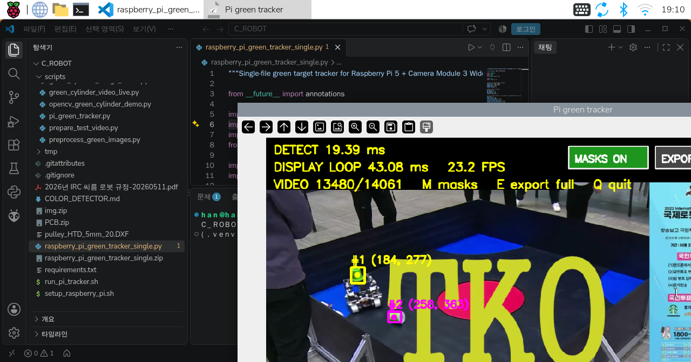
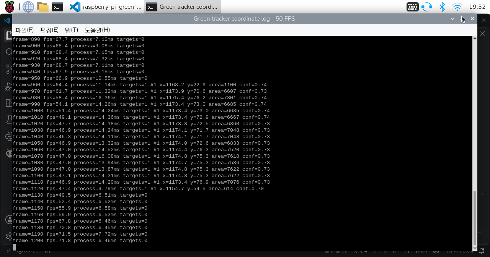

# 예전 영상 코드 (10월 초, 보존용)

10월 초에 만든 4필터(BGR/ExG/HSV/Lab) 검출기와 실험 도구다. 지금 경기용 송신은 `scripts/tower_detector_hsv.py`(HSV 검출기)를 쓴다.
비교와 재현을 위해 지우지 않는다. `pi_vision_sender.py --detector legacy`로 예전 검출기를 쓸 수 있다.

| 파일 | 역할 |
|---|---|
| `scripts/color_detection_core.py` | 원본 프레임 검출 기준: BGR/ExG/HSV/Lab, 융합, 모폴로지, 연결 성분 |
| `scripts/color_detection_lightweight.py` | 작은 영상에서 후보 ROI를 찾고 원본 ROI만 정밀 검증 |
| `scripts/pi_green_tracker.py` | 공유 검출기를 파일·USB 카메라·Picamera2에 연결. JSON 표준출력, 미리보기 (UART 송신 없음) |
| `raspberry_pi_green_tracker_single.py` | 복사하기 쉬운 단일 파일 검출기. `config/*.json`을 읽지 않음 |
| `scripts/color_detector_ui.py`, `color_detector_wizard.py` | 단계별 튜닝 UI (`config/color_detector_last.json` 저장) |
| `scripts/benchmark_lightweight_compare.py`, `color_detector_export.py`, `export_lightweight_full_video.py` | 속도 비교, 분석 영상 저장 |
| `scripts/prepare_test_video.py` | 시험 영상을 1920×1080/50fps로 변환 |
| `scripts/green_cylinder_*.py`, `preprocess_green_images.py`, `opencv_green_cylinder_demo.py`, `face_tracking_demo.py` | 초기 실험·설치 점검 |
| `scripts/generate_htd5m_20t_pulley.py` | CadQuery로 풀리 STEP/STL 생성 (영상과 무관) |
| `cv_live_view.py`, `test_hsv_tower.py`, `run_pi_tracker.sh` | 단독 예제·시험, 예전 추적기 실행 래퍼 |

예전 검출기 실행 예 (Windows):

```powershell
cd D:\C_ROBOT
.\.venv\Scripts\python.exe scripts/pi_green_tracker.py --source dataset/videos/irc_highlight_1080p50.mp4 --preview --realtime
.\.venv\Scripts\python.exe scripts/color_detector_ui.py
```

튜닝 키와 옵션은 [`COLOR_DETECTOR.md`](../COLOR_DETECTOR.md)와 각 스크립트의 `--help`. 영상·출력·가상환경은
`.gitignore`로 제외되므로 새 clone에는 시험 영상이 없을 수 있다.


## 결과 화면

| 미리보기 | 50fps 로그 |
|---|---|
|  |  |
