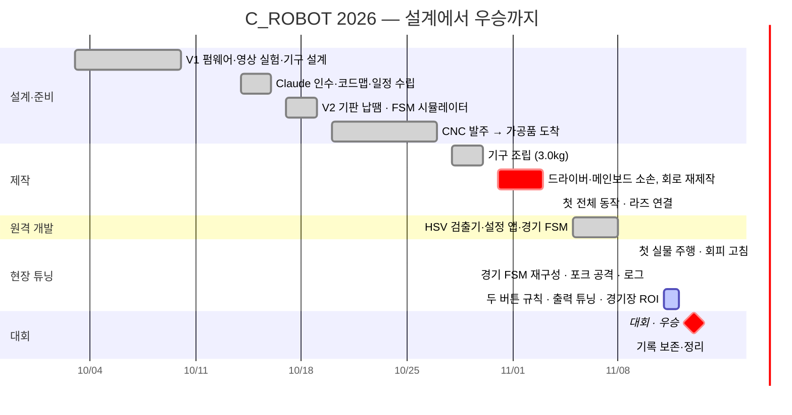

# C_ROBOT 개발 타임라인 (2026-10-03 → 2026-11-14)

2026 IRC 씨름 로봇 V2 기체를 처음 설계해서 **11/13 대회 우승(1점 차 1위)** 까지 간 42일의 기록이다.
출처는 git 커밋 79개와 PR 9개, 팀 일정 페이지(`schedule/`)의 "최근 바뀐 것", Claude Code 대화 기록(`conversation_logs/`),
대회 회고([`IRC2026_RETROSPECTIVE.md`](../IRC2026_RETROSPECTIVE.md))다. 시간은 KST 기준이다.

> 사람: **학현** (소프트웨어·회로·기구 설계), **큰놈이** (부품·3D 프린터·조립·현장), **예찬** (시험 코드).
> 학현이 로봇 곁에 있던 날은 11/2–4와 11/9–13뿐이고, 나머지는 원격으로 일했다. 부품·공구·프린터는 큰놈이에게 있었다.

## 한 장 요약

| 단계 | 기간 | 끝났을 때 상태 |
|---|---|---|
| 0. 설계·초기 펌웨어 | 10/03–10/10 | V1 펌웨어(PC 시험), 영상 필터 비교, 휠베이스 129mm·벨트 구동 확정 |
| 1. 인수·준비·발주 | 10/14–10/27 | AI 작업 규칙과 코드맵, 일정 페이지, V2 기판 납땜, CNC 가공품 도착 |
| 2. 제작·첫 실물 | 10/28–11/04 | 기구 3.0kg, 두 번의 소손을 넘고 11/4 전체 동작, 라즈 → ESP32 50Hz 오류 0 |
| 3. 원격 개발 | 11/05–11/08 | 타워 검출기·설정 앱, 경기 FSM v1 (main 병합), 3D 출력 완료 |
| 4. 현장 튜닝 | 11/09–11/12 | 경기 FSM을 단계별로 다시 짬, 포크 공격, 실행 로그, 출력 상향 |
| 5. 대회 | 11/13 | 경기 중 리셋을 현장에서 막으며 **1위** |
| 6. 정리 | 11/14 | 태그 `irc2026-final`, 회고, 주행 로그 80개, 대화 기록 보존 |

---

## 0. 설계·초기 펌웨어 (10/03–10/10)

| 날짜 | 한 일 | 근거 |
|---|---|---|
| 10/03 | 저장소 생성. 로봇 소스·하드웨어 파일 업로드, ESP32 하드웨어 요구사항 문서화 | `506086d`, `34e4e21`, `399d0f2` |
| 10/05 | **V1 펌웨어 구현·PC 검증.** AS7341 연속 측정 최적화, 센서-바닥 간격이 3/10/20mm로 변하는 조건 문서화. 모터·UART·타워 추적 벤치 모드, 정지 재무장·실시간 위험 처리 수정 | `d470b10`, `81f0a3e`, `8cb96b1`, `bcfa113` |
| 10/06 | 영상 필터(BGR/ExG/HSV/Lab) 비교 실험과 결과 보존 → 이후 HSV 검출기의 근거 | `2ee51a5`, `cv_tests/` |
| 10/10 | 기구 모델과 무게중심 시뮬레이터. **휠베이스 129mm 고정, HTD5M 20T 벨트 구동**, 코딩·안전 의도 문서(AGENTS.md) | `1c7bed7`, `1f0ee96`, `8a28610` |

## 1. 인수·준비·발주 (10/14–10/27)

| 날짜 | 한 일 | 근거 |
|---|---|---|
| 10/14 | **Codex → Claude Code 인수.** AGENTS.md를 불러오는 CLAUDE.md, AI 읽기 비용을 줄이는 `MAP.md`와 헤더 `// Contract`. 색 교정을 별도 펌웨어로 분리, 홈 탈출 추가. 현장 팀원(코딩 모름)용 `TEAM_GUIDE.md` | `cf82ce1`, `b29faad`, `89c0348`, `a788bff` |
| 10/15–16 | 일정 수립: 학현 부대·시험, 큰놈이 출장·부품 보관, 예찬 시간 부족. 팀 일정 페이지 시작 | 대화 기록 10/15–16 |
| 10/17 | **V2 기판 SMD 납땜 (학현).** 칼라·텐셔너 검토 | 일정 페이지 |
| 10/18–19 | **FSM 시뮬레이터**(브라우저 2D) 공개. 가공 파츠를 PLA로 먼저 출력해 미리 조립 | `cfa3213`, `fsm_sim/` |
| 10/20 | **JLCCNC 가공 발주** (빠른 가공 3일 + DHL Express) | 일정 페이지 |
| 10/21–22 | PLA·PETG 주문, 모터 드라이버 마운트 출력, DHL 통관 처리 | 대화 기록 |
| 10/23 | V2 기판 지원(`HW_VERSION=2`, 별도 핀맵), 전원 투입 3초 배터리 판정 | `10323a4`, `e76a862` |
| 10/24 | 구형 테스트카는 굴리지 않기로, 첫 시험은 새 기체에서. 알루미늄 환봉 8.2mm 오배송 | 일정 페이지 |
| 10/25 | **V2 기판 전원 인가 성공.** 3S·4S 배터리 모두 허용, 벨트·풀리·텐셔너 공차 확인 | `8f6aa94` |
| 10/27 | 가공품 도착 (공차 전부 맞음) | 일정 페이지 |

## 2. 제작·첫 실물 (10/28–11/04)

| 날짜 | 한 일 | 근거 |
|---|---|---|
| 10/30 | **기구 조립 완료 3.0kg**, 바퀴 4개(실리콘) 완성, 샤프트는 서스 환봉으로 임시 대체 | 일정 페이지 |
| 10/31 새벽 | ⚡ **모터 선이 바퀴에 끼어 합선 → BTS7960 1개 소손.** 3D 프린터 고장·분해 수리 | 일정 페이지 |
| 10/31 | V2 전용 벤치 펌웨어(IMU 점검, 벤치 안 색 교정, GUI), 안 쓰는 환경 `archive/`로. Claude + Codex 교차 리뷰로 핀맵 전수 확인 → **PR #1, #2**. 밤에 큰놈이 첫 보드 시험 통과(BAT 분압, GPIO35 부팅 튐 없음, IMU) | `1b352a8`, `b666e71` |
| 11/01 | 왼쪽 모터: 케이블, EN 선 단선. 양쪽 모터 반전, 핀 21칸 상태 판, I2C 스캔 → **PR #3, #4**. ⚡ **메인 보드 소손** | `60ab5ee`, `476e5a2`, `5320457` |
| 11/02–03 | 회로를 전부 다시 만들고 부품 수정. 굴러갈 정도까지 조립, IMU 간헐 끊김, 좌우 출력 차이 큼 | 대화 기록 11/03 |
| 11/04 | **첫 전체 동작.** 좌우 차이 = 드라이버 고장 → 교체. IMU 끊김 = 냉납 → 해결. 모든 버튼 0.5초 유지, **12단계 색 교정**, 라즈 5 설정(VNC·Tailscale·UART), **ESP32 수신 50패킷/초 오류 0**. 라즈 전원을 XL 벅 → USB-C PD로(부팅 부하에서 꺼지던 문제). 카메라 1080p → 720p로 지연 83 → 33ms. 무게 4,150g | `d8e04c3`, `f99c597`, `7d36eab`, `6e9381f` |

## 3. 원격 개발 (11/05–11/08)

| 날짜 | 한 일 | 근거 |
|---|---|---|
| 11/05 | **타워 설정 앱**(드래그로 색 잡기, 여러 색 범위 합치기, 모션블러·60Hz 플리커 대비), Wi-Fi 선호 순서, 배터리 판정 켜기/끄기, 벤치 결과를 경기 FSM에 반영 → **PR #5** | `bb435e5`, `758767d`, `252f48c`, `3b36d99` |
| 11/06 | 목표 추가: **새 로봇 vs 이전 로봇 대련.** LED 16 → 10가지 | 일정 페이지 |
| 11/07 | 설계 완전 완료 → 큰놈이에게 전달(뒤집힘 보호 가드 포함). 65mm 바퀴 설계. 주행 결정: Unknown 색에서는 기동 안 함, 라즈가 죽으면 무작위 순회, IMU 80° 3초면 비상정지 | 일정 페이지 |
| 11/08 | 무작위 순회·뒤집힘 정지·센서 재시도 3회·출력 상한 710 → **PR #6–#9**. 펌웨어 전체 리뷰, 일정 페이지에 규정 점검·로봇 설명·순서도 탭. 3D 출력 완료(경기장 턱 시험물 포함), 실리콘 주조, 4번 센서 교체 | `31ca653`, `15d3eb2`, `faf2f07`, `29fa6eb` |

## 4. 현장 튜닝 (11/09–11/12)

| 날짜 | 한 일 | 근거 |
|---|---|---|
| 11/09 | **경기 펌웨어 첫 실물 주행.** "생각보다 주행은 잘 되고 상대도 잘 찾음." 고친 것: 락온 중 회피는 똑바로 후진 뒤 다시 밀기, 돌진을 더 멀리서(박스 높이 420 → 280), 탐색은 한 방향 회전. 라즈 카메라 보기 검은 화면(최소 크기 0) 수정 | `674fb4b`, `49046b1` |
| 11/10 새벽 | 로그 분석(130초): 시작 루틴이 덜 돎(45° → 39°), 탐색 회전이 낮은 전압에서 안 돎, 홈과 상대 사이에 끼여 회피 10초 | 일정 페이지 |
| 11/10 | **경기 FSM을 단계별로 다시 짬 (`AlignFsm`):** 시작 루틴 → 정렬 → 돌진 → 바닥 회피(먼저 밟은 쪽 기준). **가운데 빨간 원 돌아가기, 밀려 들어갔을 때 탈출, 포크 공격**(가까이서 급제동 → 포크 삽입 → 급가속), 직진 보정(NVS), **ESP32 → 라즈 실행 로그**, 자이로 방향 추정. 라즈 전체 백업·복구 문서. 밤: 구형 V1 로봇용 펌웨어(HuskyLens, TCS34725) | `95e3455`, `4328bb5`, `3aabb7b`, `a3fd0d8` |
| 11/11 | V2 기판 초기화 문제 → **버튼 규칙 변경:** 정지 중 두 버튼 모두 시작, 구동 중 아무 버튼 0.5초 비상정지, 두 버튼 동시 0.5초 소프트 리셋. 부팅 때 두 버튼 → 벤치 모드(펌웨어 하나로 합침). 노랑 교정(앞뒤 두 번). 상대가 가까울 때 회피를 조금 늦추고 일자 후진. 출력 상향 → 롤백 → 재상향 | `8064a5f` |
| 11/12 | 돌진·포크 급가속 800, 모터 상한 1000, 밀어 넣기 대기 0. **경기장 현장 시험:** 실제 경기장 홈에는 턱이 있어 센서가 25mm까지 뜸. 라즈 설정 앱에 **화면 위쪽 ROI**(경기장 밖 녹색 제외) | `b678145` |

## 5. 대회 (11/13)

| 시각 | 일 |
|---|---|
| 08:33 | 대회 당일. 펌웨어 출력값을 이전과 비교해 확인 |
| 09:25 | ⚠ **경기 중 ESP 정지, 모터가 혼자 후진.** 상대를 800으로 밀다 후진하는 순간 로그가 끊김. core dump는 비어 있음 |
| 10:48–11:46 | LDO·ESP·벅 교체. NVS 전압 기록 시도 → 끄고 **부팅 때 리셋 원인을 라즈로 보고**(`boots.csv`), 시작 전 2초마다 반복 전송 |
| 12:42–13:12 | 실제 경기장 턱 때문에 회피 후진을 더 길고 세게, 빨간 원 돌아가기는 더 물러난 뒤 돌기. 너무 많이 빠져서 절반으로 |
| 12:59 | 라즈 **EMI가 ESP를 죽이던 원인**은 해결. 남은 것은 고출력. **1초 워치독 + 워치독 리셋이면 버튼 없이 바로 주행 재개** |
| 15:08 | 경기 중 리부트 뒤 재개가 안 됨 → **어떤 워치독 리셋이든 재개**(비상정지 상태가 아니면) |
| 16:04 | 시작 루틴(경기장 중앙으로 이동)을 빼고 바로 탐색·정렬로 시작 |
| 결과 | 🏆 **1위, 1점 차 우승** |

## 6. 정리 (11/14)

- 우승 펌웨어를 태그 **`irc2026-final`** (`0030f0b`)로 고정
- [`IRC2026_RETROSPECTIVE.md`](../IRC2026_RETROSPECTIVE.md): 최종 값, 로그 분석, 문제와 하드웨어 교훈
- 주행 로그 80개 + `boots.csv`를 `pi_backup/runs/`에 강제 추가, 분석 도구 `ESP_MAIN/tools/run_log_stats.py`
- Claude Code 대화 기록을 두 PC에서 모아 `conversation_logs/`에 날짜별로 보존(개인정보 가림)
- README 전면 개편, 이 타임라인, 예전 설계·영상 기록을 `docs/`로 분리

## 숫자로 본 42일

| 항목 | 값 |
|---|---|
| 커밋 / PR | 79 / 9 (11/14 정리 커밋 제외) |
| 펌웨어 (`ESP_MAIN/src`, `include`) | 약 10,200줄 C++ |
| 라즈·영상 파이썬 (`scripts/*.py`) | 약 6,200줄 |
| PC 회귀 시험 | V2 약 18,000회 검사 (반복 assert 포함), 벤치, V1 컴파일 |
| 주행 로그 | 80개 (11/10–11/13), 10초 이상 67판·61분 분석 |
| 하드웨어 사고 | 모터 드라이버 소손 1회·고장 1회, 메인 보드 소손 1회, 대회 중 ESP 정지 |
| Claude Code 대화 | 27일, 사용자 메시지 약 700개 |
